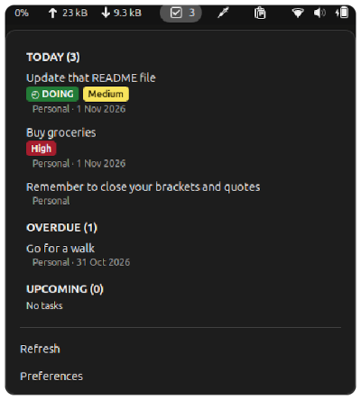

# Logseq HUD->Do


**What does HUD->Do mean?**
It stands for Heads-Up Display, Now Do It. This extension brings your Logseq tasks out of the abyss of your daily Logseq journals and puts them right in your face until they actually get done.

A native GNOME Shell 46–50 indicator with an offline, read-only Python backend for Logseq OG Markdown graphs.
The backend requires Python 3.10+ on Linux with no third-party Python dependencies.
The extension bundles the existing backend; no permanent service is installed.



## TL;DR
1.  ```sh
    ./scripts/install.sh
    ./scripts/install-extension.sh
    ```
2. Log out then log back in
3.  ```sh
    gnome-extension enable logseq-hud-do@local
    ```

## Scraper

Run the scraper (backend) from this directory:

```sh
python3 -m logseq_hud_do --graph /path/to/graph --graph-name Personal --diagnostics
```

Repeat `--graph` for multiple graphs. Optional `--graph-name` values correspond
in argument order. `--horizon 7` includes the seventh upcoming day.
`--full-rescan` reparses every discovered file. `--cache PATH` overrides
`${XDG_CACHE_HOME:-~/.cache}/logseq-hud-do/tasks.sqlite3` and must be outside
all configured graphs. Graphs must contain `pages/` or `journals/`.

For user installation, run `sh scripts/install.sh` and put `~/.local/bin` on
PATH. Then use `logseq-hud-do` with the same arguments. No sudo is required.
To uninstall, remove `~/.local/bin/logseq-hud-do` and
`${XDG_DATA_HOME:-~/.local/share}/logseq-hud-do`.

The [JSON interface v1](docs/json-interface-v1.md) defines the backend/extension contract.
Successful stdout is a JSON object containing `today`, `overdue`, and `upcoming`
arrays. Dates are ISO dates or null. Priority is A/B/C or null. Each record
includes content, status, graph display name, graph-relative source file,
source page, journal date, block location (one-based line), identifier, block
UUID if present, and a Logseq deep link. Diagnostics go to stderr; failures
produce a JSON error on stderr and a nonzero exit code. Argument syntax errors
use argparse's standard stderr usage message.

Both TODO and DOING are returned. DOING precedes TODO, then A/B/C/no priority;
dates order Overdue and Upcoming within those groups. Today uses deterministic
source order. Unscheduled tasks appear only in today's journal and only without
a deadline. Classification uses the local date on every invocation, including
warm-cache executions. Consumers should refresh on local midnight.

## Architecture and cache

`logseq_hud_do/backend.py` scans only Markdown under pages and journals,
parses blocks line by line, and stores raw extraction records in SQLite keyed
by canonical graph directory and relative path. Metadata belongs to its nearest
block, including non-task children. Fenced code is ignored. Scheduling dates
and deadlines on owned metadata lines are retained without expanding recurrence.
Both fields may share one metadata line, in either order. Malformed task-owned
scheduling values fail the refresh; date mentions within ordinary prose remain content.
Owned non-metadata continuation lines are preserved in task content.

Nanosecond mtime and size determine reuse. One transaction covers each refresh;
a Linux advisory lock serializes processes and corrupted-database recovery.
Interrupted transactions roll back. Parser/schema version changes invalidate
the index. Warm scans perform no data writes. Removed files are removed from
the index; graphs omitted from an invocation are not returned. Corrupt caches
are disposable and rebuilt. Graph files are never written. Symlink files and
subdirectories are skipped, and source opens reject symlink components.

## Development and benchmarks

`make test` requires Python 3.10+, GNOME Shell 46–50, `glib-compile-schemas`,
`gsettings`, Node.js (`node`), and GJS (`gjs`) on PATH: it includes a disposable extension installation.
For backend-only development use `python3 -m unittest discover -s tests -p 'test_backend.py' -v`.

```sh
make test
make check
make benchmark
```

Tests use temporary generated graphs only. Benchmarks generate 500, 1,000 and
5,000 files and report JSON timings and parsed counts for cold, warm, modified,
deleted, and created-file refreshes. Expected parsed counts are asserted.
`make check` compiles Python and checks installer shell syntax; no external
linter or type checker is configured.

## Limitations and troubleshooting

Only OG Markdown is supported. Journal names supported are YYYY_MM_DD,
YYYY-MM-DD, and English abbreviated/full month names such as Oct 31, 2026
(month-name parsing follows the process locale). Journal page titles support the
default English ordinal format and the exact graph setting
`:journal/page-title-format "yyyy-MM-dd, EEE"` in `logseq/config.edn`, using English
weekdays. Explicit pre-block `title::` takes precedence. Settings are read on
every scan, including warm scans. Missing, unreadable, malformed or symlinked
config and other formats retain the default fallback; arbitrary custom formats
and Logseq DB graphs remain unsupported. Dates without valid ISO calendar
values and invalid UTF-8 fail the refresh with source context. Deadline dates do not classify
tasks. Markdown is never executed or rendered.

Without a UUID, identifiers hash graph, file, original task text, status and
same-text occurrence. They survive unrelated inserted lines, but changing task
text/status, moving files, or reordering identical tasks can change identity.
Duplicate block UUIDs within a graph return the first source occurrence.
See [navigation diagnostics and manual acceptance](docs/navigation-acceptance.md).
Deep links depend on Logseq's registered desktop protocol and graph basename;
the backend does not launch Logseq or verify protocol registration.

If metadata was preserved by another tool, use `--full-rescan`. If a graph or
cache is unreadable, fix its permissions or use another cache location. A file
changed or deleted during reading can fail the invocation; retry the refresh.
SQLite failures report an error; damaged databases rebuild automatically.
A graph actively being rewritten is not a graph-wide filesystem snapshot.

## GNOME Shell extension

Targets GNOME Shell **46, 47, 48, 49 and 50**, with GJS, Python 3.10+, GTK 4, libadwaita and
`glib-compile-schemas` (provided by the GNOME desktop development/runtime packages).
The original development environment was GNOME Shell 46.0 and GJS 1.80.2.
Metadata declares these five versions based on static API review; live runtime
compatibility is not yet verified on any version other than 46.0. See [compatibility evidence](docs/gnome-compatibility.md).

```sh
sh scripts/install-extension.sh
# Log out and back in after installation (also after updating on Wayland).
gnome-extensions enable logseq-hud-do@local
gnome-extensions prefs logseq-hud-do@local
```

Add each graph by absolute directory path and an optional display name. To change
an existing path or name, remove that entry and add it again. Preferences also
control refresh seconds (default 30), upcoming days (default 7), Overdue/Upcoming
visibility, and the panel Today count. Today always remains visible.
Directories must contain non-symlink pages/ or journals/. The backend validates graph access
again on every refresh. Missing or unreadable graphs display an error rather
than stale tasks; correct the directory and select Refresh.

The scrollable dropdown preserves backend order within TODAY, OVERDUE, UPCOMING.
Only DOING gets a status badge. Priority badges are High (red), Medium (amber),
Low (blue); absent priorities have no badge. Text is displayed literally.
Preferences provide independent line regex and multiline block filters for displayed
task descriptions; source Markdown and the SQLite cache are unchanged. Line filters
keep their restricted, anchored regex syntax and hide `relay-id::` lines by default.
Block filters use literal start/end markers on separate lines, ignoring surrounding
whitespace. The default pair is `:LOGBOOK:` / `:END:`. Multiple blocks are removed,
including their markers, while surrounding text remains. The first matching end
closes a block; blocks do not nest. Unclosed blocks remain visible. Blank markers
are ignored, and the first configured pair wins for duplicate starts. Remove all
entries in either list to disable that kind of filtering independently.

Rows include the graph and, when scheduled, its date (for example `4 Nov 2026`).
Colors use explicit contrasting foreground/background pairs while ordinary text
inherits the Shell theme. Graph/date context uses about 67% opacity of that theme
foreground; task descriptions retain full opacity.

Refresh occurs on open, manually, periodically, after settings changes, and at
local midnight. Concurrent requests coalesce into one follow-up scan. Disabling
removes timers, disconnects settings, cancels communication and terminates the
child. The backend runs through argument-vector invocation, never a shell.
Clicking a task launches its backend-provided Logseq URI through the registered
local desktop handler. Without a handler an explanatory message appears;
Logseq need not run for reading tasks. No editing or completion is provided.

```sh
make test-extension
make check-extension
```

Development checks additionally require Node.js for the widget test harness and
JavaScript syntax checks; Node.js is not needed at runtime.

Focused tests run pure model/lifecycle code in the installed GJS, exercise Shell
widget rendering and cleanup with a small test double, and install into a
temporary XDG directory to scan a generated graph using the bundled backend.
Static checks compile the schema strictly, parse JavaScript, and check installer
shell syntax. No JavaScript linter or type checker is configured.

Live acceptance (requires a desktop session on each of GNOME 46–50): enable the extension,
configure disposable graphs with long tasks and all priorities, verify scrolling,
keyboard navigation, panel count, all empty states and badge contrast under both
light and dark Shell themes and display scaling. Open a task with Logseq's URI
handler registered, then without it; check the error message. Change settings,
cross local midnight, and disable during a scan; confirm no surviving child or
callbacks. These interactive checks are not claimed by the automated harness.

For Shell errors inspect `journalctl --user -b` and `gnome-extensions info
logseq-hud-do@local`. After an update restart the session to reload modules.
To uninstall, disable the extension and remove
`${XDG_DATA_HOME:-~/.local/share}/gnome-shell/extensions/logseq-hud-do@local`.
The cache is shared with the CLI and can be removed separately.

### Hidden tasks

Hover over a task or focus it with the keyboard to reveal Hide. The Shell
confirmation defaults to Cancel; Escape cancels. Hiding changes only extension
settings, never Markdown. Preferences → Hidden Tasks supports search, Unhide,
and confirmed Unhide All, synchronized with the running extension.

Hidden tasks persist in a version 2 GSettings registry. Identity uses the
canonical graph directory, resolved originating page title, normalized task text
and scheduled date. Tasks share hidden status when graph, page, normalized content and scheduled
date all match. Distinct resolved page titles remain separate. Changing the journal
title configuration can reveal tasks whose resolved title changes; hidden status
is not preserved across title formats.
Different scheduled dates or graphs produce separate hidden identities. TODO/DOING and priority changes preserve it; text,
page, graph directory or scheduled-date changes can reveal a task. Display
filters do not affect identity. Old experimental UUID records are not migrated.
